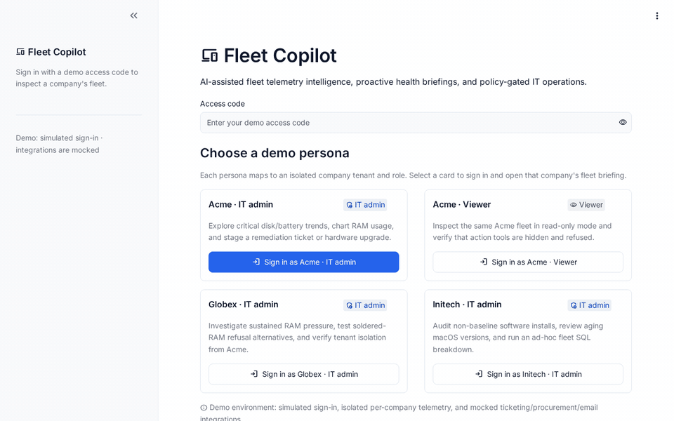
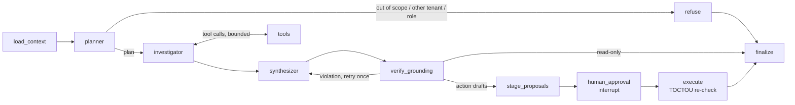

# Agentic Fleet Copilot

An AI copilot for IT fleet telemetry: ask questions in plain English, get answers where **every fact cites a
telemetry snapshot**, see 30-day trends, and **propose actions that only run after a human approves them**.

### [▶ Try the live demo — rayda.bertslab.com](https://rayda.bertslab.com)

Access code in the submission email · or run it locally with no API key: `cp .env.example .env && docker compose up --build`
(open http://localhost:8501, code `dev`).

[](https://github.com/SouravSharan/agentic-fleet-copilot/actions/workflows/ci.yml)



**Results:** 51/51 eval cases (77 runs) · 4 hard gates at 100 % (citation validity, safety, audit integrity,
privacy) · 13/13 red-team cases pass 3 times in a row · 29/29 tenant-isolation attacks blocked · replays offline for $0.

Python 3.12 · LangGraph · Gemini 3.8 Flash · PostgreSQL 16 (row-level security) · Streamlit — by
Sourav Sharan ([@SouravSharan](https://github.com/SouravSharan)).

---

## Installation & setup

```bash
# Docker: everything in containers, no API key needed
cp .env.example .env && docker compose up --build        # → http://localhost:8501

# Developer workflow (Python 3.12 + uv + Docker)
uv sync --all-groups
make bootstrap        # .env, Postgres, migrate, seed 750 snapshots, test DB, offline eval
```

Add `GEMINI_API_KEY` to `.env` only for live chat or re-recording evals. All settings:
[docs/07 › Configuration](docs/07-deployment-and-operations.md#configuration-reference).

## Running the agent

- **Web UI** — `make ui` or the Docker stack. Four personas across three companies (admin and viewer roles):
  Home briefing, Copilot chat with citations and an Inspector, Approvals & audit log, Fleet, How it works.
- **CLI** — `make chat COMPANY=acme-001 ROLE=it_admin`, or `uv run fleet-copilot ask "Which devices at Acme are low on disk space?" --company acme-001`.
- **API** — `make api` → http://127.0.0.1:8000/docs.

## Running evaluations

```bash
make eval            # replay 51 core cases / 77 runs from recorded cassettes (~80 s, $0, no key)
make security-probe  # 29 live attacks on tenant isolation — all must be BLOCKED
make test            # unit, integration, graph, API, UI tests
```

Deterministic graders against an oracle computed from the dataset (no LLM judge); red-team cases run 3×; CI fails
on any hard-gate miss or regression. First recording scored 49/51; one too-literal grader was fixed and the same
cassettes re-graded — both numbers are reported. Method and results: [docs/06](docs/06-evaluation.md).

## Agent architecture



An explicit LangGraph graph: a planner that refuses unsafe requests before any tool runs, a bounded tool-calling
loop, a structured answer that must cite evidence, a deterministic verifier, and a human-approval interrupt before
any side effect. Details: [docs/03](docs/03-agent-architecture.md).

## Tool catalog

| Tool | What it does | Roles |
|---|---|---|
| `get_fleet_overview` | Device counts by form factor, OS, model, compliance | viewer, admin |
| `find_devices` | Filter devices by hardware, OS version, disk, RAM, battery, software | viewer, admin |
| `query_compliance` | Compliance checks by severity / status / check | viewer, admin |
| `get_device_details` | One device: profile, 30-day stats, compliance, software | viewer, admin |
| `get_employee_devices` | All devices of one employee | viewer, admin |
| `analyze_fleet_trends` | 30-day analyzers: battery end-of-life, RAM pressure, disk burn, compliance drift, software | viewer, admin |
| `list_action_proposals` | Pending and past proposals | viewer, admin |
| `create_chart` | Validated Vega-Lite chart from telemetry (`[C#]`) | viewer, admin |
| `run_readonly_sql` | Governed single `SELECT` over 5 non-PII views (`[Q#]`) | viewer, admin |
| `create_upgrade_order` | Draft RAM / storage / battery upgrade | admin |
| `open_remediation_ticket` | Draft a ticket for a failing check, low disk or risky software | admin |
| `flag_device_for_replacement` | Draft a replacement for end-of-life hardware | admin |
| `notify_employee` | Draft a message about that employee's devices | admin |

Action tools keep the brief's signatures plus a required `evidence` list, so nothing can be drafted without
citing the telemetry that justifies it. Policies and lifecycle: [docs/04](docs/04-tools-actions-policies.md).

## Grounding strategy

- Counts, thresholds and trends are computed in SQL/Python; the model reasons over results, not raw JSON.
- Every tool result registers evidence with a handle (`[E#]` snapshot, `[C#]` chart, `[Q#]` query); the model can
  only cite handles that exist, and each opens the exact snapshot, value and timestamp in the UI.
- A deterministic verifier rejects uncited claims and devices not in cited evidence (one retry, then caveats).

Details: [docs/05](docs/05-grounding-and-guardrails.md), [ADR 0003](docs/adr/0003-evidence-handles-and-verifier.md).

## Guardrails

- **Tenant isolation** in Postgres: signed tenant lock + fail-closed row-level security, so even a bad tool call
  or a missed refusal returns no other-company data.
- **Human approval** for every action: propose → policy check → approve → fresh-telemetry re-check → execute.
- **Refusal without evidence**, with verified alternatives (e.g. soldered RAM → replacement or ticket).
- **Hash-chained audit log** of every turn, tool call and decision; role checks; prompt-injection filtering;
  PII redaction; spend and rate caps.

Each guardrail and the test that proves it: [docs/05 › Guardrails at a glance](docs/05-grounding-and-guardrails.md#6-guardrails-at-a-glance).

## Key design decisions & trade-offs

| Decision | Trade-off |
|---|---|
| Explicit graph with planner, bounded loop and verifier | More moving parts than one ReAct prompt, but inspectable and budgeted |
| Deterministic analytics + evidence handles instead of vector RAG | Exact and traceable; new question types need tools (or governed SQL) |
| Isolation enforced by the database, not just app code | Holds even if the model or a tool is wrong; slightly more DB plumbing |
| Propose → approve → execute with mock integrations | No side effect without a human; integrations are simulated (exact payloads shown) |
| Record/replay evals with code graders | Free, reproducible CI; prompt changes need a paid re-record |

More: [ADRs](docs/adr/). Known limitations — ~14.5 s per live turn, 51 core cases on synthetic data, mocked
integrations, demo sign-in — are listed in [docs/06](docs/06-evaluation.md#10-limitations-and-next-steps).

## Documentation

[System & tenancy](docs/01-system-and-tenancy.md) · [Data model](docs/02-data-model.md) ·
[Agent architecture](docs/03-agent-architecture.md) · [Tools, actions & policies](docs/04-tools-actions-policies.md) ·
[Grounding & guardrails](docs/05-grounding-and-guardrails.md) · [Evaluation](docs/06-evaluation.md) ·
[Deployment](docs/07-deployment-and-operations.md) · [Reviewer guide](docs/reviewer-guide.md) · [ADRs](docs/adr/)

## How this was built

I designed, directed and own this project, using AI assistants the way I'd use a team: Google Gemini (Antigravity)
generated most of the code and tests from my specifications, and Anthropic Claude (Claude Code) reviewed, audited
and drafted documentation. I made the calls on requirements, architecture and trade-offs; every change passed my
review and automated gates. I take full responsibility for the result and am happy to walk through any part of it.
