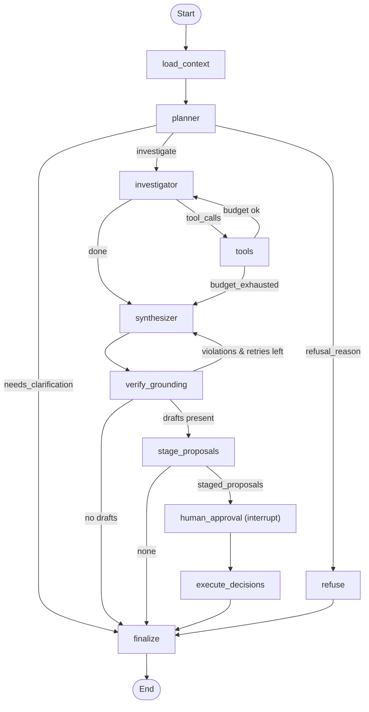

# 03 · Agent Architecture

## 1. Orchestration Graph

Fleet Copilot runs as a compiled LangGraph `StateGraph(CopilotState, context_schema=TenantContext)` defined in [`src/fleet_copilot/agent/graph.py`](../src/fleet_copilot/agent/graph.py). Tenant identity (`company_id`, `actor_id`, `role`, `trace_id`) is injected through LangGraph's immutable `context_schema` — never placed in LLM-controlled tool arguments.

## 2. Node Responsibilities

| Node | Module | Job |
|---|---|---|
| `load_context` | [`nodes/load_context.py`](../src/fleet_copilot/agent/nodes/load_context.py) | Resets per-turn state lists, resolves effective tenant policies (`PolicyService`), filters the 13 tools via `tools_for()` (RBAC + global kill-switch + tenant toggles), caches tenant hostnames and `telemetry_as_of`, and seeds a fresh `EvidenceLedger`. |
| `planner` | [`nodes/planner.py`](../src/fleet_copilot/agent/nodes/planner.py) | Lightweight Gemini call (`thinking_level: low`) returning structured `Plan` JSON. Immediately routes cross-tenant requests, role violations, and out-of-scope prompts to `refuse` with zero tool calls; routes ambiguous questions straight to `finalize`. |
| `refuse` | [`nodes/refuse.py`](../src/fleet_copilot/agent/nodes/refuse.py) | Builds a deterministic refusal `Answer` (without confirming whether another tenant exists) and records an `access_denied` audit event. |
| `investigator` | [`nodes/investigator.py`](../src/fleet_copilot/agent/nodes/investigator.py) | Runs Gemini with the caller's allowed tools bound. Sees only the last 4 complete turns (trimmed strictly at `HumanMessage` boundaries) plus the current turn's tool loop, keeping thought signatures intact. |
| `tools` | [`nodes/tools.py`](../src/fleet_copilot/agent/nodes/tools.py) | Enforces cooperative deadlines, total tool budget, per-tool call caps, RBAC re-check, Pydantic argument validation (stripping any stray `company_id`), execution, `ToolCalledPayload` audit logging, and `ToolMessage` neutralization. |
| `synthesizer` | [`nodes/synthesizer.py`](../src/fleet_copilot/agent/nodes/synthesizer.py) | Fresh-prompt Gemini call returning structured `Answer` JSON (`summary`, `result_device_ids`, `claims`, `insight_refs`, `proposal_refs`, `caveats`). Receives the compact evidence ledger digest, tool summaries, and last 3 conversation digest turns — never raw tool-call `AIMessage` history. |
| `verify_grounding` | [`nodes/verify_grounding.py`](../src/fleet_copilot/agent/nodes/verify_grounding.py) | Deterministic verifier over all `Answer` fields (`claims`, `result_device_ids`, `summary`, `caveats`). On hard citation/device violations it retries `synthesizer` once; if still violated it strips offending claims/references and audits `grounding_violation`. Soft numeric mismatches warn without stripping. |
| `stage_proposals` | [`nodes/stage_proposals.py`](../src/fleet_copilot/agent/nodes/stage_proposals.py) | Persists policy-approved action drafts into `copilot.action_proposals` (`pending_approval`) via `ActionService.stage()`, builds the `approval_packet` with `approval_hash`, and records `action_proposed`. |
| `human_approval` | [`nodes/human_approval.py`](../src/fleet_copilot/agent/nodes/human_approval.py) | Calls LangGraph `interrupt(approval_packet)` to pause the thread cleanly until an `it_admin` submits `approve`, `reject`, or `defer` decisions via `CopilotService.resume()`. |
| `execute_decisions` | [`nodes/execute_decisions.py`](../src/fleet_copilot/agent/nodes/execute_decisions.py) | Applies human decisions through `ActionService.decide()` and executes approved proposals via `ActionService.execute()` (with TOCTOU re-check and idempotent recovery). |
| `finalize` | [`nodes/finalize.py`](../src/fleet_copilot/agent/nodes/finalize.py) | Renders Markdown + `[E/C/Q]` footnotes, updates `copilot.turns` (`response_json`, token counts, latency, hashes), audits `turn_completed`, and appends a compact summary to `conversation_digest`. |

## 3. State & Evidence Ledger

`CopilotState` ([`src/fleet_copilot/agent/state.py`](../src/fleet_copilot/agent/state.py)) is JSON-native (except `messages`, which preserves LangChain `AIMessage` Gemini thought signatures inside AES-encrypted checkpoints). Per-turn accumulators (`tool_trace`, `tool_outputs`, `insights`, `charts`, `queries`, `drafts`, `verdicts`, `warnings`, `usage`) use `turn_list_reducer` so `load_context` resets them cleanly at the start of every turn while `messages`, `evidence`, and `conversation_digest` persist across turns.

The **Evidence Ledger** ([`src/fleet_copilot/domain/evidence.py`](../src/fleet_copilot/domain/evidence.py)) assigns deterministic sequential handles scoped to the thread:
- **`E<n>`**: per-device telemetry snapshot facts (`snapshot_id`, `device_id`, `hostname`, `collected_at`, `metric`, `value`, `label`), deduplicated by `(snapshot_id, device_id, metric)`.
- **`C<n>`**: validated Vega-Lite chart artifacts produced by `create_chart` (linked to `evidence_snapshot_ids`).
- **`Q<n>`**: governed `run_readonly_sql` query artifacts (linked to `snapshot_ids`, `device_ids`, and `rows`).

## 4. Conversation History, Trimming & Persistence

- **Checkpointing**: LangGraph `PostgresSaver` backed by `copilot.checkpoint*` tables using `EncryptedSerializer.from_pycryptodome_aes()` (`LANGGRAPH_AES_KEY`).
- **Actor-owned threads & leases**: Every thread in `copilot.threads` is owned by `(company_id, actor_id)` and protected by a compare-and-set run lease (`copilot.threads.run_lease_until`, 90 s, released in `finally`) so one thread runs one turn at a time ([`tests/integration/test_thread_ownership_and_lease.py`](../tests/integration/test_thread_ownership_and_lease.py)).
- **History bounds**: Maximum **30 turns per thread** (`copilot.turns`). Before each `investigator` call, history is trimmed to the **last 4 complete turns** strictly on `HumanMessage` boundaries ([`tests/unit/test_history_trimming.py`](../tests/unit/test_history_trimming.py)) so tool-call / tool-result pairs are never orphaned. `planner` and `synthesizer` receive the compact **3-turn `conversation_digest`** (`user`, `summary`, `result_device_ids`, `refused_alternatives`) for referential follow-ups ("what about the MacBook Pro?").
- **Auto-defer on paused threads**: Sending a new user message while a thread is paused at `human_approval` automatically resumes the interrupt with `defer` on all pending proposals (leaving them `pending_approval` in the queue) before running the new turn ([`tests/graph/test_agent_graph.py`](../tests/graph/test_agent_graph.py)).

## 5. Budgets, Deadlines & Failure Handling

Configured in [`config/runtime.yaml`](../config/runtime.yaml):
- **Total tool calls per turn**: `8` (`budget_exhausted` flag routes straight to `synthesizer` with a warning, leaving zero dangling tool calls).
- **Per-tool call caps**: `get_fleet_overview: 2`, `analyze_fleet_trends: 3`, `list_action_proposals: 3`, `create_chart: 3`, `run_readonly_sql: 3`, `get_device_details: 6`, other tools: `4`. Cap rejections count toward `step_count` so a looping model terminates cleanly.
- **Verifier retries**: `1` retry on hard violations; `recursion_limit: 30`.
- **Cooperative turn deadline**: `60 s` checked before every LLM and tool invocation ([`src/fleet_copilot/agent/deadline.py`](../src/fleet_copilot/agent/deadline.py)); per-node HTTP timeout `45 s`, max retries `2`. Any uncaught LLM error, parse failure, or deadline expiry marks the turn `failed`, reports actual DB proposal status truthfully, and records a `turn_completed` audit event.
