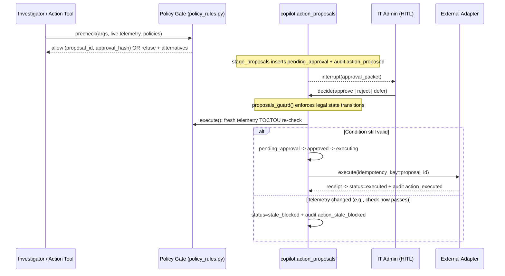

# 04 · Tools, Actions & Policies

## 1. Tool Catalog (13 Registered Tools)

All 13 tools are seeded in `copilot.tenant_tool_configs` ([`db/02_copilot.sql`](../db/02_copilot.sql)) and filtered at runtime by `tools_for()` ([`src/fleet_copilot/tools/registry.py`](../src/fleet_copilot/tools/registry.py)). Global disabled rows (`company_id = '*'`) act as a platform kill-switch that tenant overrides cannot bypass. `ACTIONS_ENABLED=false` disables all 4 action tools globally.

| Tool | Kind | Min Role | Per-Turn Cap | Purpose |
|---|---|---|---:|---|
| `get_fleet_overview` | Read | `viewer` | 2 | Tenant fleet counts by form factor, OS, model, compliance, and active thresholds |
| `find_devices` | Read | `viewer` | 4 | Filter latest device state by hardware, OS semver, disk, RAM, battery, or software |
| `query_compliance` | Read | `viewer` | 4 | Query compliance checks by severity/status/check_id; returns verified zero-match evidence |
| `get_device_details` | Read | `viewer` | 6 | Single-device profile, 30-day metric stats, compliance history, and installed software |
| `get_employee_devices` | Read | `viewer` | 4 | All devices owned by one `employee_id` inside the caller's tenant |
| `analyze_fleet_trends` | Read | `viewer` | 3 | 30-day deterministic analyzers: battery EOL, sustained RAM, disk depletion, compliance drift, non-baseline software |
| `list_action_proposals` | Read | `viewer` | 3 | List staged/historical action proposals for the current tenant |
| `create_chart` | Read | `viewer` | 3 | Compute validated Vega-Lite v5 chart (`C<n>`), persist personal saved chart in `copilot.charts` |
| `run_readonly_sql` | Read | `viewer` | 3 | Governed single-`SELECT` analytics over 5 non-PII `telemetry.v_*` views (`Q<n>`, `LIMIT <= 200`, 3 s timeout) |
| `create_upgrade_order` | Action | `it_admin` | 4 | Propose RAM, storage, or battery upgrade order (policy-gated against hardware catalog) |
| `open_remediation_ticket` | Action | `it_admin` | 4 | Propose ITSM remediation ticket for failing compliance checks, low disk, or non-baseline software |
| `flag_device_for_replacement` | Action | `it_admin` | 4 | Propose hardware replacement for EOL/multi-signal or non-upgradable degraded devices |
| `notify_employee` | Action | `it_admin` | 4 | Propose employee notification strictly scoped to devices owned by that employee |

## 2. Policy Resolution Cascade

Policies live in `copilot.tenant_policies` and resolve via `PolicyService.resolve()` ([`src/fleet_copilot/services/policy.py`](../src/fleet_copilot/services/policy.py)) in strict precedence order: **device override → tenant override → global default (`company_id = '*'`)**. Every resolved threshold carries its `(value, source)` provenance into tool outputs, answers, and action checks.

Key global defaults: `low_disk_free_pct = 15.0%`, `high_ram_used_pct = 80.0%`, `ram_sustained_ratio = 0.7`, `battery_eol_cycles = 800`, `software_baseline_min_share = 0.8`, `flagged_software_list = [uTorrent, TeamViewer, CleanMyMac X]`, `cooldown_days_upgrade = 30`, `cooldown_days_ticket = 7`, `cooldown_days_replacement = 90`, `cooldown_hours_notify = 72`, `proposal_ttl_hours = 72`, `stale_device_days = 7`, `replacement_min_signals = 2` (19 global defaults in total; see `db/02_copilot.sql`).

## 3. Deterministic Action Policy Gate (Offer-Only Refusals)

Action tools **never execute** external side effects when called by the LLM. Instead, each tool runs a deterministic precheck in [`src/fleet_copilot/domain/policy_rules.py`](../src/fleet_copilot/domain/policy_rules.py) against live telemetry, tenant policies, and `copilot.hardware_catalog` (6 seeded models recording soldered vs. upgradable RAM/storage and desktop/laptop battery eligibility):

- **Allow**: returns a deterministic `uuid5` `proposal_id`, check verdicts, and evidence handles; queues a draft for `stage_proposals`.
- **Refuse**: blocks staging, records a `verdict` with exact failed check(s) and **verified alternatives** (each alternative is pre-validated against the same policy rules so dead-end suggestions are impossible — [`tests/integration/test_no_dead_end_alternatives_dataset.py`](../tests/integration/test_no_dead_end_alternatives_dataset.py)). The agent never auto-stages an alternative; it explains the refusal reason and tells the user how to request the alternative explicitly.

Examples enforced in [`tests/integration/test_refusal_matrix_dataset.py`](../tests/integration/test_refusal_matrix_dataset.py):
- Soldered RAM (`ThinkPad X1 Carbon Gen 11`, `MacBook Pro`, `Mac mini`) → `create_upgrade_order(ram)` refused; offers `flag_device_for_replacement` / `open_remediation_ticket`.
- Desktop (`Mac mini`) → `create_upgrade_order(battery)` refused (no battery hardware).
- Passing compliance check → `open_remediation_ticket` refused (no active failure).
- Healthy device with no qualifying risk signals → `flag_device_for_replacement` refused.
- Cross-employee device mismatch → `notify_employee` refused (prevents leaking another employee's device issues).

## 4. Propose → Human Approval → TOCTOU Re-Check → Execute

Key lifecycle guarantees:
- **DB-enforced state machine**: Trigger `copilot.proposals_guard()` ([`db/02_copilot.sql`](../db/02_copilot.sql), [`tests/integration/test_proposal_guard.py`](../tests/integration/test_proposal_guard.py)) freezes immutable columns (`approval_hash`, `args_json`, `expires_at`), rejects any update on terminal rows (`rejected`, `expired`, `executed`, `failed`, `stale_blocked`), and restricts reviewer/execution fields to their exact transitions.
- **Deduplication, cooldown & expiry**: Deterministic `dedupe_key` prevents duplicate pending proposals; cooldown windows block repeat orders/tickets; expired proposals transition to `expired` before execution ([`tests/integration/test_dedupe_and_cooldown.py`](../tests/integration/test_dedupe_and_cooldown.py), [`tests/integration/test_expiry.py`](../tests/integration/test_expiry.py)).
- **TOCTOU freshness re-check**: Immediately before calling an external adapter, `ActionService.execute()` re-queries live telemetry and re-runs the policy gate. If the underlying issue already resolved, the proposal transitions to `stale_blocked` and the adapter is never called ([`tests/integration/test_toctou_stale_block.py`](../tests/integration/test_toctou_stale_block.py)).
- **Integration outbox**: on success the adapter's exact outbound payload (ServiceNow ticket, procurement order, employee email, asset-lifecycle flag) is written to `copilot.integration_outbox` in the same transaction as the `executed` status, so the UI shows precisely what would have been sent. All adapters are mocks in this build.
- **Bounded retries & idempotent crash recovery**: Adapter exceptions increment `attempts`; after 3 failed attempts the proposal is marked `failed` with exactly one `action_failed` audit event so `recover_executing()` cannot loop indefinitely ([`tests/integration/test_execute_recovery_is_idempotent.py`](../tests/integration/test_execute_recovery_is_idempotent.py)).

## 5. Append-Only Hash-Chained Audit Log

Every significant event (`turn_started`, `tool_called`, `grounding_violation`, `access_denied`, `action_proposed`, `action_decided`, `action_executed`, `action_failed`, `action_stale_blocked`, `turn_completed`, `chart_created`, etc.) is written to `copilot.audit_logs` via `AuditService` ([`src/fleet_copilot/services/audit.py`](../src/fleet_copilot/services/audit.py)). Each row chains `row_hash = SHA-256(prev_hash || canonical_fields)` under a per-tenant advisory lock (`pg_advisory_xact_lock`). `copilot_app` holds `SELECT, INSERT` only (`UPDATE`/`DELETE`/`TRUNCATE` revoked + immutability trigger). Verified by [`tests/integration/test_audit_chain.py`](../tests/integration/test_audit_chain.py) and [`tests/integration/test_privacy_scan.py`](../tests/integration/test_privacy_scan.py).
